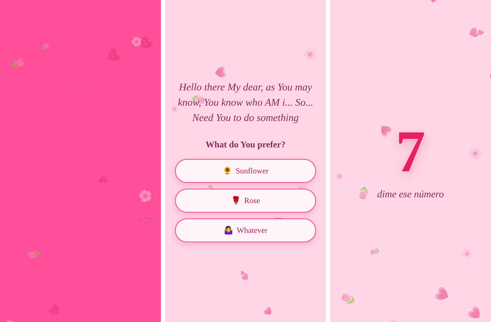

# Sorpresa 💗

App de Android (APK) sorpresa.

- **Instalar:** descarga `Sorpresa.apk` en el teléfono, ábrelo y permite "instalar apps de origen desconocido". Requiere Android 7.0 o superior.
- **Flujo:** pantalla rosa → cambia lentamente a rosa pastel mientras aparece el mensaje → 2 s después, "What do You prefer?" con 3 botones → muestra el número (Sunflower = 7, Rose = 9, Whatever = 0) y "dime ese número".
- **Editar textos/colores:** `src/assets/index.html`.
- **Recompilar:** `./build.sh` (necesita Java y Python con Pillow; descarga apktool y apksig solo).

